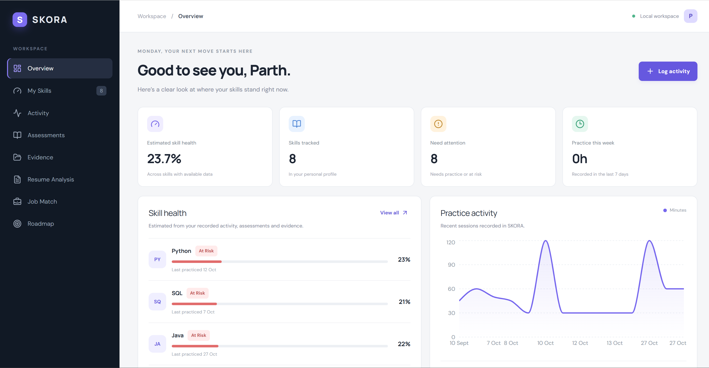
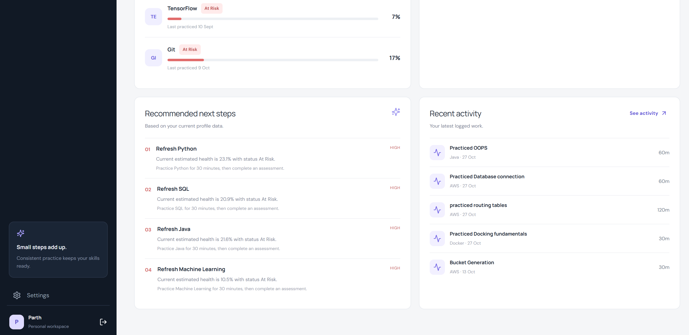
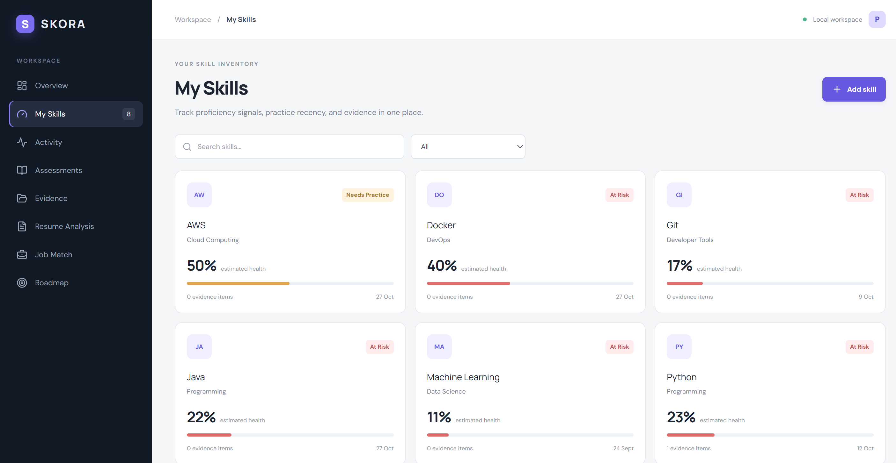
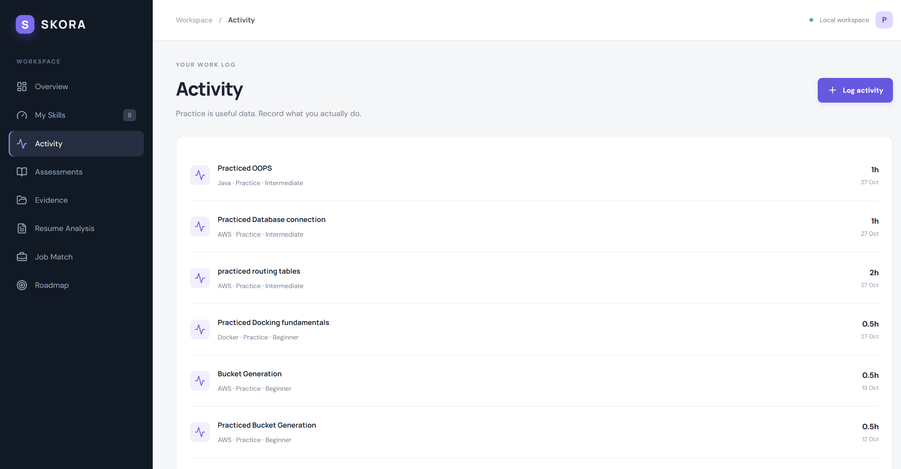
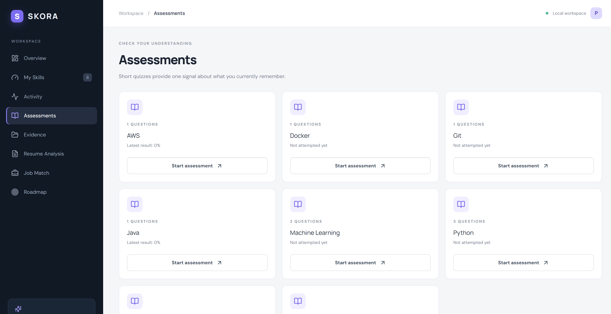
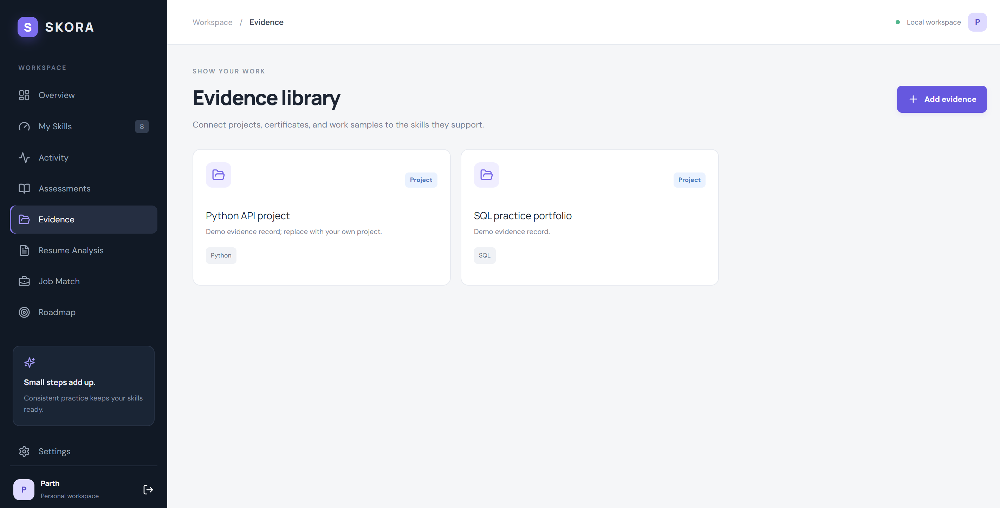
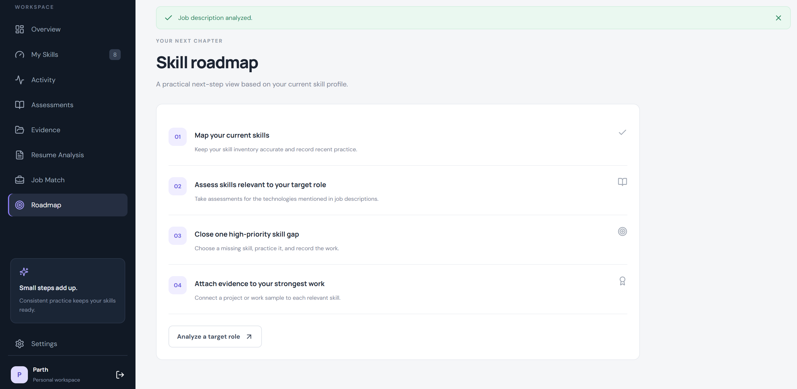

# SKORA — A Personal Skill Intelligence Platform

SKORA is a full-stack skill intelligence platform designed to help users track technical skills, monitor learning activities, evaluate assessment performance, maintain project evidence, and identify career-related skill gaps.

It combines skill tracking, assessment analytics, explainable skill-health scoring, and rule-based recommendations in one platform.

## Key Features

- **Skill Management:** Create, manage, and monitor technical skills.
- **Activity Tracking:** Record learning activities and track practice history.
- **Skill Assessments:** Attempt assessments and review performance history.
- **Skill Health Analytics:** Calculate explainable skill-health estimates using multiple learning indicators.
- **Evidence Management:** Associate project evidence and supporting documents with skills.
- **Resume Analysis:** Extract text from PDF and DOCX resumes and identify relevant skills.
- **Job Description Matching:** Compare resume skills against job requirements and identify potential skill gaps.
- **Personalized Recommendations:** Generate rule-based suggestions to guide learning and practice.
- **Interactive Dashboard:** View skill metrics, learning progress, and recent activities.
- **AI-Assisted Quizzes:** Gemini integration is included in the codebase; verify its configuration and end-to-end functionality before relying on it.

## Technology Stack

| Layer | Technologies |
|---|---|
| Frontend | React, TypeScript, Vite |
| Styling | Tailwind CSS |
| Backend | Python, FastAPI |
| Database | SQLite |
| ORM | SQLAlchemy |
| Validation | Pydantic |
| Authentication | JWT, password hashing |
| Analytics | Python-based rule-driven scoring |
| Document Processing | PDF and DOCX text extraction |
| AI Integration | Google Gemini API |

## How Skill Health Is Calculated

SKORA uses a transparent, rule-based scoring approach to estimate skill health.

The scoring algorithm considers four indicators:

1. **Assessment Performance (40%)** — Average assessment performance.
2. **Practice Recency (25%)** — How recently the user practised a skill.
3. **Practice Consistency (20%)** — Recorded practice activity over the previous 30 days.
4. **Evidence (15%)** — Number of evidence records associated with a skill.

The weighted indicators are combined to calculate a skill-health estimate. When some indicators are unavailable, the available weights are normalized.

### Skill Health Categories

| Score | Category |
|---|---|
| 80–100 | Strong |
| 65–79 | Stable |
| 45–64 | Needs Practice |
| Below 45 | At Risk |
| Not enough data | Insufficient Data |

**Note:** Skill health is a heuristic estimate, not a scientifically validated measurement of professional competence.

## Project Architecture

SKORA follows a frontend-backend architecture.

- The React frontend provides the user interface and dashboard.
- The FastAPI backend exposes REST APIs and handles application logic.
- SQLAlchemy manages database interactions.
- SQLite stores application data.
- The scoring module calculates skill-health estimates and recommendations.

See the detailed documentation:

- [System Architecture](docs/architecture.md)
- [Scoring Algorithm](docs/algorithms.md)
- [Database Design](docs/database.md)
- [User Guide](docs/user_guide.md)

## Project Structure

```text
SKORA/
│
├── backend/
│   ├── app/
│   │   ├── routers/
│   │   ├── tests/
│   │   ├── main.py
│   │   ├── database.py
│   │   ├── models.py
│   │   ├── schemas.py
│   │   ├── security.py
│   │   ├── scoring.py
│   │   ├── documents.py
│   │   ├── ai_quiz.py
│   │   └── seed.py
│   ├── requirements.txt
│   └── .env.example
│
├── frontend/
│   ├── src/
│   ├── public/
│   ├── package.json
│   └── vite.config.ts
│
├── docs/
│   ├── algorithms.md
│   ├── architecture.md
│   ├── database.md
│   ├── user_guide.md
│   └── SKORA-Project-Presentation.pdf
│
├── .gitignore
└── README.md
```

## Getting Started

Follow these steps to run SKORA locally.

### Prerequisites

- Python 3.11 or later
- Node.js 20 or later
- npm
- Git

### 1. Clone the Repository

```bash
git clone <YOUR_GITHUB_REPOSITORY_URL>
cd SKORA
```

### 2. Set Up the Backend

Open a terminal:

```bash
cd backend

python -m venv .venv
```

Activate the virtual environment.

**Windows PowerShell:**

```powershell
.\.venv\Scripts\Activate.ps1
```

**macOS/Linux:**

```bash
source .venv/bin/activate
```

Install dependencies:

```bash
pip install -r requirements.txt
```

Configure environment variables using the example file:

**Windows PowerShell:**

```powershell
Copy-Item .env.example .env
```

Add your own Gemini API key to `.env` if you want to use the AI integration.

Never commit your actual `.env` file or API keys.

Initialize the sample data:

```bash
python -m app.seed
```

Start the backend:

```bash
uvicorn app.main:app --reload
```

Backend URL: `http://127.0.0.1:8000`

Interactive API documentation: `http://127.0.0.1:8000/docs`

### 3. Set Up the Frontend

Open a second terminal from the project root:

```bash
cd frontend
npm install
npm run dev
```

Frontend URL: `http://localhost:5173`

The frontend is configured to proxy `/api` requests to the backend. If required, configure `VITE_API_URL` in the frontend environment.

### 4. Access the Application

Open `http://localhost:5173` in your browser and register or log in.

Keep both the backend and frontend terminals running while using the application.

## Testing

Run backend tests from the backend directory:

```bash
pytest
```

## Important Limitations

- SKORA is an academic MVP intended for local development and evaluation, not a production-hardened service.
- Skill-health scores are heuristic estimates and should not be interpreted as objectively validated proficiency measurements.
- Evidence scoring considers the number of linked evidence records, not their quality.
- Resume parsing is text-based. Scanned or image-only PDFs may require OCR.
- Job matching uses a curated skill dictionary and rule-based matching, not hiring-outcome prediction.
- External certification verification and GitHub activity integration are not implemented.
- Historical analytics depend on the data actually stored in the application.
- AI-assisted quiz functionality requires valid API configuration and end-to-end testing.

## Future Scope

- Integration with GitHub to analyse coding activity and project contributions.
- Advanced learning analytics and progress visualizations.
- More comprehensive skill assessments.
- Improved resume parsing and skill extraction.
- Personalized learning roadmaps.
- Cloud deployment and production-grade security.

## Project Documentation

Additional project documentation and the academic presentation are available in the [`docs/`](docs/) directory.

---


## Application Screenshots

### Dashboard




### Skills Management


### Activity Tracking


### Assessments


### Evidence Management


### Resume Analysis


### Job Matching


### Learning Roadmap



**SKORA — Track Skills. Measure Progress. Build Your Future.**
