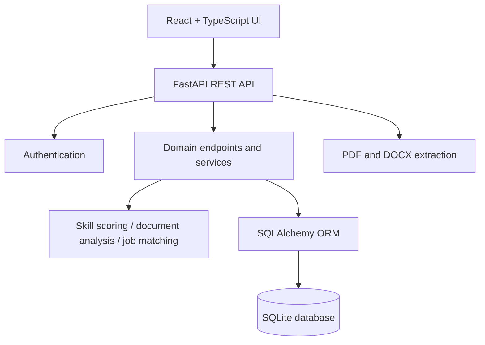

# Architecture

The frontend uses JSON REST endpoints under `/api`. FastAPI validates inputs and enforces authenticated user ownership. SQLAlchemy persists user data. Intelligence functions are kept in separate modules so their behavior can be tested independently.
